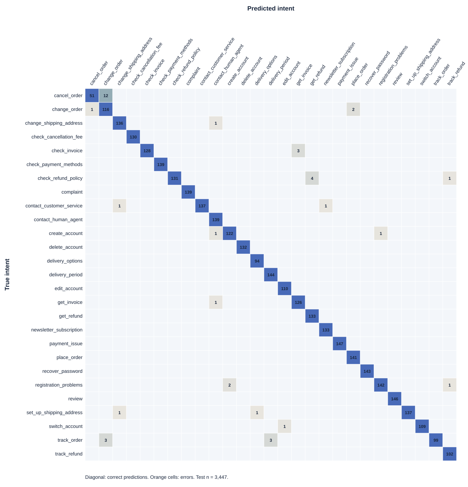

# Intent Classification for a Simulated Customer Support Chatbot

**Course:** Natural Language Processing, Semester I 2026–2027  
**Project type:** Individual project  
**Student name and ID:** To be inserted by the student before submission  
**Report status:** Draft based on frozen G1–G4 evidence; final PDF and submission links pending

## 1. Introduction

This project classifies English customer requests into 27 support intents. A local chatbot then maps the predicted intent to a reviewed store answer. The store, Demo Tech Store, is simulated. It has no live order, payment, account, or agent system.

The main question is whether a fixed sentence embedding improves intent classification over word-count features. The study compares Bag-of-Words (BoW), TF-IDF, and a frozen sentence encoder. Logistic Regression and Linear SVM provide the supervised classifiers. Macro-F1 on validation selects the final model. One held-out Bitext test evaluation checks the selected model.

A second question concerns safe chatbot behavior. A high intent score may still accompany an unclear or out-of-scope request. The demo therefore separates intent prediction from response selection. It can guide, ask for clarification, state a scope boundary, or suggest human support. These actions are evaluated on a small, separate challenge set.

The contributions are concrete: a versioned dataset split, five controlled experiments, a frozen model bundle, and an offline demo. The report also records errors and known limits. High scores on synthetic customer-support text do not establish production reliability.

## 2. Related Work

BoW represents each request through token counts. TF-IDF downweights terms that appear across many documents. Both create sparse word features; neither directly models the meaning of an entire sentence. The project uses scikit-learn's `CountVectorizer`, `TfidfVectorizer`, and `Pipeline` for these baselines [2]. A pipeline fits its vocabulary and IDF inside the training stage.

Sentence-BERT introduced sentence representations designed for semantic comparison [3]. This project uses the pretrained `all-MiniLM-L6-v2` Sentence Transformer as a fixed encoder [4]. It produces a 384-dimensional vector for each request. A separate Logistic Regression model learns the 27 labels. The encoder is not fine-tuned on Bitext.

The comparison asks a narrower question than general semantic search. It measures supervised intent classification on one Bitext split. The same split and macro-F1 metric support comparison, while the different representations remain distinct pipelines. The challenge set probes behavior that ordinary in-scope test accuracy cannot measure.

## 3. Dataset Description

### 3.1 Source and task definition

The source is the Bitext Customer Support LLM Chatbot Training Dataset [1]. The project pins revision `430d1a89bd93bd1fa23c16f29dd53e73f0087443`. The downloaded CSV has SHA-256 `6f81102b0100b97b8468eb04368033a23206bf1fde9d53500d5806ec1001a434`. Its publisher lists the license as CDLA-Sharing-1.0. The raw file contains 26,872 rows, 27 intents, and 11 observed categories.

The input `X` is only the customer's `instruction`. The target `y` is `intent`. The `category`, `response`, and `flags` columns never enter the classifier. A customer's sentence is available in a live chat; the reference response is not. Using that response as a feature would leak task information.

One source request reads `question about cancelling order {{Order Number}}`. Another asks, `I need to know if there is anything new on the restitution`. Placeholders are part of the dataset, not real customer records. The dataset is hybrid synthetic. Repeated templates and unusual phrasing limit how far its test scores can generalize.

### 3.2 Audit, deduplication, and split

No missing values were found across the five source columns. Normalizing Unicode, case, punctuation, and whitespace leaves 24,072 unique instructions. The audit removes 2,800 duplicate rows. It finds no normalized instruction assigned to conflicting intents.

The split uses seed 42 and groups likely near-duplicates within each intent. It aims at a 70/15/15 allocation. A later exhaustive same-intent string check found holdout matches at `SequenceMatcher >= 0.90`. The project removed 125 validation rows, 133 test rows matching train, and 27 more test rows matching validation. These removals total 285 rows.

| Partition | Requests | Use |
| --- | ---: | --- |
| Train | 16,849 | Fit preprocessing, vectorizers, and classifiers |
| Validation | 3,491 | Choose model settings and compare experiments |
| Test | 3,447 | Evaluate the frozen choice once |

The final exhaustive check finds zero same-intent cross-split matches at that string threshold. This check has a narrow meaning. It cannot detect every semantic paraphrase, shared template, or ambiguous label. The `cancel_order` class illustrates the imbalance after cleaning: 998 raw rows became 421 unique requests, then 420 retained requests. Its final allocation is 295 train, 62 validation, and 63 test.

The two invoice intents reuse only four literal invoice numbers. Such repetition can help a classifier learn dataset patterns that may not hold for new customers. The report therefore treats Bitext test results as an internal benchmark.

### 3.3 Challenge set

The project prepared 44 additional customer requests with AI assistance and student review. The student approved all 44 before training. The set has 22 `tuning` cases and 22 `final` cases. Across the set, in-scope requests cover all 27 intents. Other cases test ambiguity and out-of-scope behavior.

The tuning portion helps choose action thresholds. The final portion is used after the bundle is frozen. A string check found no same-intent in-scope challenge request above 0.75 similarity to the source. That check does not prove semantic independence. The final portion also has a disclosure described in Section 7.

## 4. Methodology

### 4.1 Text processing

The sparse-feature pipelines apply three preprocessing techniques. First, Unicode NFKC, case folding, apostrophe handling, and whitespace cleanup reduce surface variation. Common negative contractions are expanded: `don't` becomes `do not`. Second, a regex tokenizer extracts words, numbers, and complete Bitext placeholders. For example, `{{Order Number}}` becomes `slot_order_number`. Third, POS-aware WordNet lemmatization maps inflected words to their base forms. Negation words such as `not`, `no`, and `never` stay intact. Stop-word removal is omitted because short words can change intent.

Each sparse model is an scikit-learn pipeline. The text processor runs before its vectorizer and classifier. The vectorizer learns its vocabulary from train only. TF-IDF also learns document frequencies from train only. Validation and test use the fitted transforms.

E5 follows a different input path. It encodes the original instruction without G2 lemmatization. The pinned `all-MiniLM-L6-v2` revision is `1110a243fdf4706b3f48f1d95db1a4f5529b4d41`. Its publisher lists Apache-2.0. The encoder produces normalized, 384-dimensional embeddings. Logistic Regression learns from the frozen train embeddings.

### 4.2 Experimental models

| Code | Representation | Classifier | Selected C |
| --- | --- | --- | ---: |
| E1 | BoW | Logistic Regression | 10 |
| E2 | BoW | Linear SVM | 1 |
| E3 | TF-IDF | Logistic Regression | 10 |
| E4 | TF-IDF | Linear SVM | 1 |
| E5 | Frozen sentence embeddings | Logistic Regression | 10 |

E1–E4 use word unigrams and bigrams, `min_df=2`, and at most 50,000 features. Their fitted vocabularies each contain 3,714 features. Every experiment checks `C` values 0.1, 1, and 10. The selection rule prioritizes validation macro-F1, then accuracy, then the smaller `C` on a tie. E5 uses the same `C` grid and the same train/validation split.

Macro-F1 gives each intent equal weight. This matters because cleaning left some classes smaller than others. Accuracy and macro precision/recall provide additional views. Per-class reports and confusion matrices expose individual failures.

### 4.3 Decision policy and response source

The final classifier predicts an intent and exposes `predict_proba`. This score compares the trained intent classes. It is not a calibrated probability that a request belongs to the store's scope. The policy also checks maximum cosine similarity against normalized training embeddings. Its frozen thresholds are 0.396708 for scope similarity and 0.663174 for clarification probability.

The policy was chosen on challenge `tuning`, with validation guards. It penalized missed scope boundaries more than rejected guide requests. The chosen thresholds yielded no validation scope refusals and a 0.020624 validation confidence-clarification rate. On tuning, all four ambiguous and all four out-of-scope cases reached their expected actions. Only four of thirteen expected guide requests did so. These counts show the policy's cost: it asks for clarification on some valid requests.

The demo selects answer text from a separate store KB. It never treats Bitext's `response` field as store policy. All 27 intent answers and four fallback replies were approved by the student on 28 October 2026. The KB distinguishes real demo functions from simulated processes.

## 5. Experiments

### 5.1 Validation comparison

All five experiments use the frozen split. E1–E4 compare two representations under two classifiers. A fixed-`C=1` comparison helps separate those factors from hyperparameter choice. E5 tests whether fixed sentence embeddings improve macro-F1.

| Model | Validation accuracy | Macro precision | Macro recall | Macro-F1 |
| --- | ---: | ---: | ---: | ---: |
| E1 | 0.982240 | 0.980942 | 0.980587 | 0.980507 |
| E2 | 0.983959 | 0.983620 | 0.982410 | 0.982836 |
| E3 | 0.985677 | 0.986088 | 0.983639 | 0.984594 |
| E4 | 0.985391 | 0.985784 | 0.983832 | 0.984585 |
| E5 | **0.990261** | **0.989783** | **0.990112** | **0.989829** |

E3 and E4 differ by only 0.000009 macro-F1. This split does not support a meaningful superiority claim between them. E5 exceeds E3 by 0.005235 macro-F1 on validation. The project selected E5 before opening the Bitext test set.

### 5.2 Preprocessing ablation

The ablation holds E3 and `C=10` fixed. Removing normalization changes macro-F1 from 0.984594 to 0.985008. Replacing the regex tokenizer with whitespace splitting lowers it to 0.980763. Removing lemmatization lowers it to 0.982922. These are one-split observations, not universal effects. The tokenizer change has the largest observed drop.

### 5.3 Freeze and final evaluation protocol

The E5 classifier, encoder revision, train embedding bank, split hashes, and decision thresholds were frozen together. The bundle SHA-256 is `fb3a88dfbbed4f90ce004f1c5b07470da28ea6ef9df8ab47c60f6978fb1bc17e`. The project then ran one Bitext test evaluation and one challenge-final evaluation. Neither result selected or retuned the bundle.

## 6. Results

### 6.1 Held-out Bitext test

E5 makes 3,406 correct predictions and 41 errors across 3,447 test requests. Accuracy is 0.988106. Macro precision is 0.987943; macro recall is 0.984357; macro-F1 is 0.985686. The difference between accuracy and macro recall matters: errors are concentrated in a few intents.

The table lists every class. Precision, recall, and F1 are rounded to three decimals; support is exact. The machine-readable report retains full precision.

| Intent | Support | Precision | Recall | F1 |
| --- | ---: | ---: | ---: | ---: |
| cancel_order | 63 | 0.981 | 0.810 | 0.887 |
| change_order | 119 | 0.885 | 0.975 | 0.928 |
| change_shipping_address | 137 | 0.986 | 0.993 | 0.989 |
| check_cancellation_fee | 130 | 1.000 | 1.000 | 1.000 |
| check_invoice | 131 | 1.000 | 0.977 | 0.988 |
| check_payment_methods | 139 | 1.000 | 1.000 | 1.000 |
| check_refund_policy | 136 | 1.000 | 0.963 | 0.981 |
| complaint | 139 | 1.000 | 1.000 | 1.000 |
| contact_customer_service | 139 | 1.000 | 0.986 | 0.993 |
| contact_human_agent | 139 | 0.979 | 1.000 | 0.989 |
| create_account | 124 | 0.984 | 0.984 | 0.984 |
| delete_account | 132 | 1.000 | 1.000 | 1.000 |
| delivery_options | 94 | 0.989 | 1.000 | 0.995 |
| delivery_period | 144 | 0.980 | 1.000 | 0.990 |
| edit_account | 110 | 0.991 | 1.000 | 0.995 |
| get_invoice | 127 | 0.977 | 0.992 | 0.984 |
| get_refund | 133 | 0.971 | 1.000 | 0.985 |
| newsletter_subscription | 133 | 0.993 | 1.000 | 0.996 |
| payment_issue | 147 | 1.000 | 1.000 | 1.000 |
| place_order | 141 | 0.986 | 1.000 | 0.993 |
| recover_password | 143 | 1.000 | 1.000 | 1.000 |
| registration_problems | 145 | 0.993 | 0.979 | 0.986 |
| review | 146 | 1.000 | 1.000 | 1.000 |
| set_up_shipping_address | 139 | 1.000 | 0.986 | 0.993 |
| switch_account | 110 | 1.000 | 0.991 | 0.995 |
| track_order | 105 | 1.000 | 0.943 | 0.971 |
| track_refund | 102 | 0.981 | 1.000 | 0.990 |

Figure 1 shows the full 27-by-27 confusion matrix. Its source table is `reports/g3/E5_test_confusion.csv`. The largest off-diagonal cell is `cancel_order` predicted as `change_order` 12 times. `check_refund_policy` becomes `get_refund` four times. `check_invoice` becomes `get_invoice` three times. `track_order` becomes `change_order` and `delivery_period` three times each.

*Figure 1. E5 test confusion matrix. Cell labels show counts; color intensity is scaled within each true class.*

### 6.2 Challenge-final actions

The final challenge partition has 22 requests. The intent is correct for 11 of 14 in-scope requests. The selected action is correct for 13 of 22 requests.

| Expected action | Correct | Total |
| --- | ---: | ---: |
| Guide | 8 | 14 |
| Clarify | 2 | 4 |
| Scope boundary | 3 | 4 |

Six of fourteen valid guide requests were clarified. Two of four ambiguous requests received a guide action. One of four out-of-scope requests was clarified instead of receiving the scope boundary. The sample is too small to estimate deployment performance. Its final partition was not fully blind, as Section 7 explains.

### 6.3 Runtime and demo checks

Latency was measured on an Apple Silicon CPU, with `OPENBLAS_NUM_THREADS=4`. The run used five warm-up requests and 50 measured, single-message validation requests. Median latency was 8.382 ms; p95 was 9.500 ms. The timed path includes encoding, classification, full-train cosine search, and action selection. Model load took 0.449 seconds separately. The classifier file is 81,519 bytes. The float32 train embedding bank is 25,880,192 bytes; encoder weights add about 91 MB locally.

The local FastAPI and React demo loads the frozen G3 bundle. Its path is `predict -> decide -> retrieve -> respond`. It serves guide, clarify, scope-boundary, and handoff flows from the reviewed KB. It stores demo sessions in a fresh local SQLite database. Admin endpoints require authentication. The G4 checks covered missing model or KB, explicit contact consent, knowledge editing, and a real-model API smoke run. All 17 project tests passed at the KB-approval handoff. A production frontend build also succeeded.

## 7. Error Analysis

The largest Bitext test error group mixes cancellation with order changes. Twelve `cancel_order` requests become `change_order`. The `cancel_order` recall is 0.810, despite 0.988 overall accuracy. Its smaller retained training set may contribute, but this experiment does not isolate that cause.

Several errors reflect nearby business meanings. A request about refund policy can look like a request to obtain a refund. An invoice check can look like an invoice retrieval request. Short misspellings also reduce lexical clarity. The saved test predictions contain examples such as `trackorder {{Order Number}}`, predicted as `change_order`.

The challenge cases expose different failures. Case F03 says the customer is *not* trying to cancel, yet the classifier predicts `cancel_order` with high confidence. A guide action would then retrieve the wrong KB answer. Cases F14 and F15 show that a high class score can still accompany an ambiguous request. Thresholds alone do not solve these language errors.

There are four material validity limits. First, Bitext is hybrid synthetic and repeats templates. Second, the 0.90 near-duplicate check covers string similarity, not all meaning-level overlap. Third, challenge final has only 22 cases. Fourth, its rows appeared during initial schema inspection before model freeze. Selection code did not use those rows, but the final challenge result is **not fully blind**. The Bitext test split was not inspected before freeze. The report keeps these two evidence levels separate.

The chatbot also has product limits. It does not look up shipments, change accounts, process refunds, or contact a live agent. Contact records stay in a local SQLite file after explicit form submission. The demo lacks a production retention policy and deployment configuration. Its behavior demonstrates the pipeline; it is not a validated customer-service operation.

## 8. Conclusion

On the frozen validation split, E5 reaches 0.989829 macro-F1 and exceeds the four sparse-feature models. The selected model reaches 0.985686 macro-F1 on held-out Bitext test. These results answer the internal classification question for this dataset.

The challenge result changes the practical conclusion. Only 13 of 22 final actions match the expected action. Negation, ambiguous requests, and scope decisions still produce errors. The local demo therefore keeps clarification and scope-boundary responses visible. Future work needs a larger, human-reviewed challenge set and real customer wording before any operational claim. It should measure calibration and decision costs without using the current test or challenge final for retuning.

### Reproducibility and contribution

The dataset and encoder revisions, split hashes, model bundle, scripts, and machine-readable results are stored with the project. A fresh Python environment passed installation and tests. A temporary empty clone reproduced the split hashes, E1–E5 validation scores, E5 classifier hash, and training-embedding hash. Its restored model served a local API chat. The held-out test and challenge-final reports were not rerun. The first source snapshot is [commit a81b9d1](https://github.com/Quang1226/ASM_NLP/commit/a81b9d14f273456654eb7c719b1dd9c20680813b). Replace this link with the final commit or tag after all G5 files are pushed. Add the demo-video link after recording and hosting.

| Member | Student ID | Work | Contribution |
| --- | --- | --- | ---: |
| Student name to insert | Student ID to insert | Data audit, preprocessing, experiments, evaluation, demo, report | 100% |

### References

1. Bitext Innovations. [Bitext Customer Support LLM Chatbot Training Dataset](https://huggingface.co/datasets/bitext/Bitext-customer-support-llm-chatbot-training-dataset), project-pinned revision `430d1a89bd93bd1fa23c16f29dd53e73f0087443`.
2. scikit-learn developers. [Feature extraction from text](https://scikit-learn.org/stable/modules/feature_extraction.html#text-feature-extraction) and [Pipelines](https://scikit-learn.org/stable/modules/compose.html#pipeline).
3. Nils Reimers and Iryna Gurevych. [Sentence-BERT: Sentence Embeddings using Siamese BERT-Networks](https://arxiv.org/abs/1908.10084), 2019.
4. Sentence Transformers. [all-MiniLM-L6-v2 model card](https://huggingface.co/sentence-transformers/all-MiniLM-L6-v2/tree/1110a243fdf4706b3f48f1d95db1a4f5529b4d41), pinned revision `1110a243fdf4706b3f48f1d95db1a4f5529b4d41`.

### Evidence map

| Claim or figure | Project evidence |
| --- | --- |
| Source revision, license, and SHA-256 | `data/source_manifest.json` |
| Raw rows, categories, missing values, duplicates | `reports/data_audit.json` |
| Split counts and excluded near-duplicates | `reports/split_report.json`, `reports/split_similarity.json` |
| Challenge authorship, review, and partitions | `data/challenge/challenge_manifest.json`, `reports/challenge_audit.json` |
| E1–E4 setup, metrics, and ablation | `reports/g2/methodology.md`, `reports/g2/best_by_experiment.json`, `reports/g2/ablation.json` |
| E5 validation and frozen policy | `reports/g3/e5_validation.json`, `reports/g3/frozen_bundle.json` |
| Test metrics, challenge actions, latency | `reports/g3/final_evaluation.json` |
| Per-class scores and full confusion matrix | `reports/g3/E5_test_per_class.json`, `reports/g3/E5_test_confusion.csv` |
| Representative errors | `reports/g3/E5_test_predictions.csv`, `reports/g3/challenge_final_predictions.csv` |
| Demo behavior and KB approval | `reports/g4/implementation.md`, `reports/g5/kb_approval.md` |

**Submission note.** The assignment PDF describes a shared Google Drive folder. The later project plan records a Google Form with one file under 100 MB. The final route must follow the instructor's current LMS guidance.
